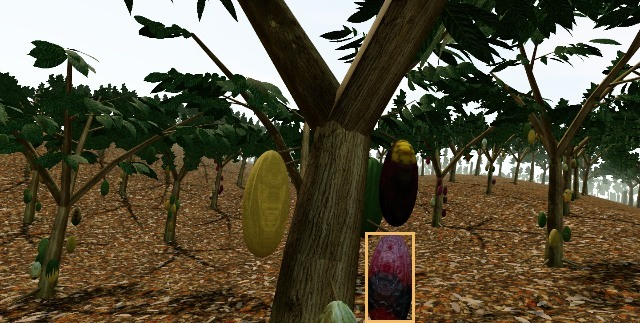

# Cacao: visión artificial y robots para inspeccionar una chacra

Proyecto de Hack the Andes, Perú · Track Clima y Territorio.

La moniliasis daña el fruto del cacao. Este prototipo conecta un detector YOLO11s entrenado con fotografías reales a una simulación de inspección con un dron y robots terrestres.

**[Ver presentación (3 diapositivas)](output/pdf/Cacao-Presentacion-Final.pdf)** · **[Entrenamiento y evaluación](research/cacao-improvement/README.md)** · **[Cómo ejecutar la chacra virtual](simulator/ORCHARD.md)**



## Qué puedes explorar

- Entrenamiento con 1,655 fotografías reales de cacao y sus aumentos.
- Evaluación externa en 399 fotografías: 191 de 200 fotos con Monilia activaron alerta; 8 de 199 fotos sanas también activaron alerta.
- El mismo detector procesa imágenes RGB de la cámara virtual. El simulador integra navegación, batería y retorno a la base.

La evaluación anterior corresponde a fotografías. La simulación muestra la integración; las pruebas en una chacra real son el siguiente paso.

**If you work on computer vision or agricultural robotics:** this repository contains a YOLO11s cacao disease detector trained on real photographs, its evaluation, and a drone/ground-robot orchard simulation. See the training report and simulator documentation above. Feedback on generalization to field images is welcome.

Si te sirve el proyecto, una estrella ayuda a que más personas lo encuentren. Puedes abrir un [issue](https://github.com/b3rs3rk1ng/hacktheandes/issues) con preguntas, fallos o propuestas para probarlo con imágenes de campo.

## Componentes

- [Aplicación Onda](app/README.md): avisos locales por audio, receptor web e integración iOS.
- [Simulación](simulator/README.md) y [chacra virtual](simulator/ORCHARD.md): escenarios, vehículos, control, visión y evidencia de pruebas.
- [Entrenamiento base de cacao](research/cacao-training/README.md): preparación de datos, detector de moniliasis y evaluación.
- [Mejora del detector y clasificador](research/cacao-improvement/README.md): protocolo, entrenamiento, benchmark, modelos y resultados.
- [Pesos externos: enlaces de descarga](research/model-discovery/free-options/DOWNLOADS.md).
- [Búsqueda de modelos](research/model-discovery/README.md), [validación Bagua](research/bagua-validation/REPORT.md), auditorías y fuentes en `research/`.
- [Fuentes del proyecto](docs/FUENTES.md) y presentaciones en `output/`.

## Ejecutar la aplicación

Requiere Node.js 22 o posterior.

```sh
cd app
npm ci
npm test
npm run build
npm run validate
npm run dev
```

Para el simulador y el entrenamiento, seguir sus README: requieren dependencias y recursos adicionales. Algunas configuraciones y evidencias conservan rutas del equipo usado originalmente; deben adaptarse al entorno de ejecución. Los datasets completos se descargan desde las fuentes documentadas.

## Qué se conserva en Git

Se incluyen código, configuraciones, lockfiles, documentación, resultados y evidencias de evaluación, recursos gráficos de la simulación, modelos entrenados seleccionados con sus fichas, y presentaciones.

Se excluyen credenciales y tokens, perfiles de navegador, entornos y dependencias instaladas, compilaciones y cachés, descargas masivas de datasets, pesos externos descargados durante la búsqueda, copias de fotos originales, capturas HTML de páginas externas y material temporal. También se excluyen documentos de autorización con datos personales. Estas exclusiones sólo afectan a Git; los archivos locales se conservan. La política está en `.gitignore` y en los `.gitignore` de cada componente.

Los datos, bibliotecas, modelos y recursos de terceros conservan sus propias condiciones de uso; consultar las fichas, atribuciones y reportes. Los resultados son de investigación y simulación: no acreditan diagnóstico de laboratorio, vuelo real ni retirada autónoma segura de frutos.

## Historial y automatización

Se conserva el historial previo de la aplicación; el commit de integración mueve su contenido a `app/` y agrega los demás componentes. No se incorporan workflows de GitHub Actions. Cualquier workflow futuro debe usar exclusivamente runners propios (`self-hosted`).
